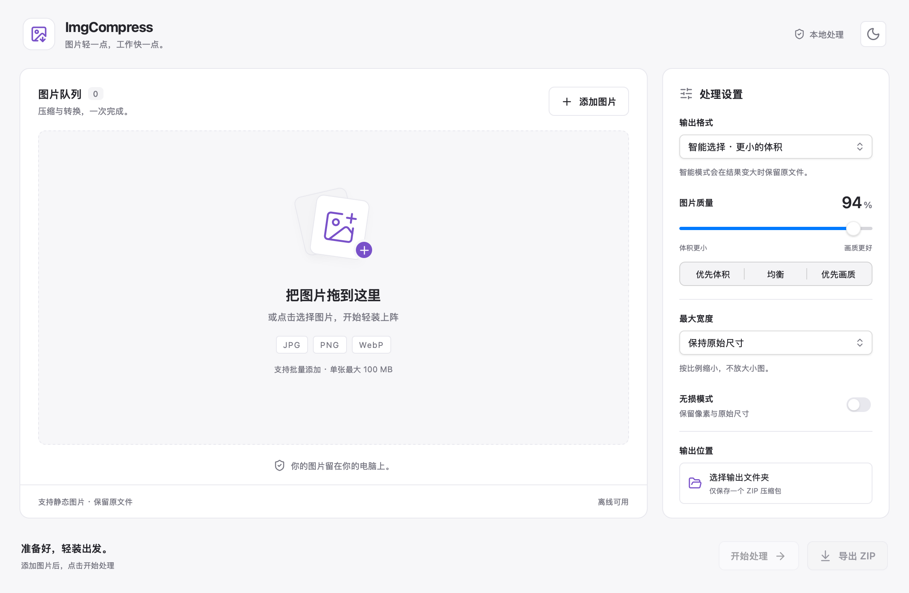
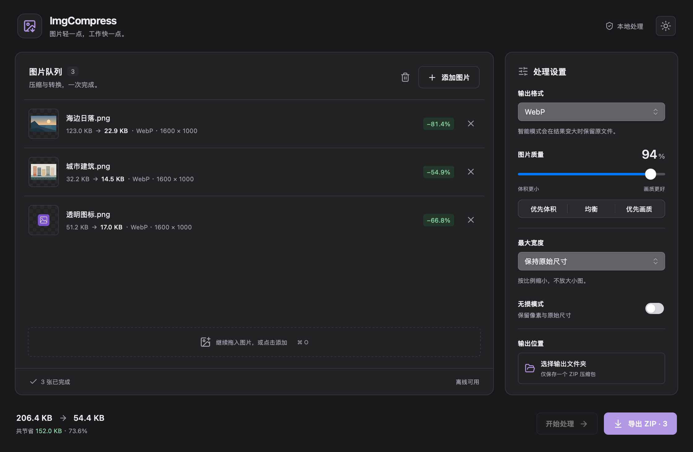
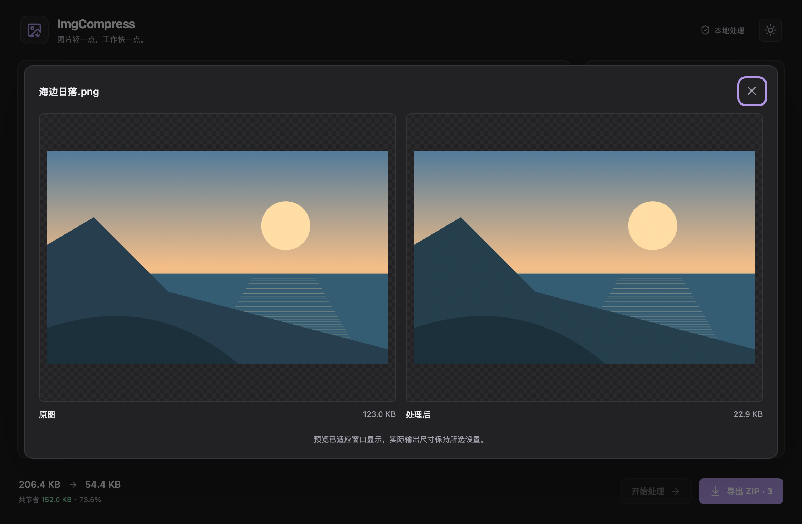

# ImgCompress Mac

基于 [MyGo](https://mygo.run/zh) 的轻量 macOS 图片压缩与格式转换工具。界面使用 React，图片在 WKWebView 内本地处理，Go 提供原生输出文件夹选择和文件保存。

## 下载

[下载 v0.1.3 · macOS Apple Silicon（DMG）](https://github.com/wangruofeng/imgcompress-mac/releases/download/v0.1.3/imgcompress-0.1.3-arm64.dmg) · [版本说明](https://github.com/wangruofeng/imgcompress-mac/releases/tag/v0.1.3) · [SHA-256 校验和](https://github.com/wangruofeng/imgcompress-mac/releases/download/v0.1.3/SHA256SUMS.txt)

以上已发布的 0.1.3 支持 JPG/PNG/WebP；本仓库 0.2.2 源码新增 AVIF/SVG/GIF/APNG，可自行构建。

适用于 Apple Silicon Mac（M 系列芯片），最低 macOS 12。当前安装包使用 ad-hoc 签名，尚未通过 Apple Developer ID 签名与公证。

## 界面预览

### 主界面 · 浅色模式

拖入图片，设置输出格式、质量和尺寸，处理全程在本机完成。



### 批量压缩 · 深色模式

查看每张图片处理前后的体积，完成后统一导出一个 ZIP 压缩包。



### 原图与结果对比

点击图片可预览处理前后的效果和文件大小。



截图来自 0.1.3 版本的实际 Mac 应用，使用专门制作的示例图片；压缩比例仅代表截图中的样本。

## 安装与使用

从上方下载 DMG，打开后将 ImgCompress 拖入 Applications。自行构建时，安装包和应用位于 `build/darwin-arm64/`。

1. 拖入图片或点击「添加图片」，支持多选和 ⌘O。
2. 选择格式、质量和最大宽度，点击「开始处理」。
3. 点击缩略图查看原图和处理结果。
4. 点击「导出 ZIP」，首次选择保存文件夹。所有已完成图片打包成一个 ZIP，导出成功后自动打开 Finder 并选中 ZIP，之后也可点击文件夹图标再次定位。失败或未完成图片不会加入。

应用默认保留输入文件。仅输出一个 `ImgCompress-日期-时间.zip`；包内图片名为 `原名-compressed.真实扩展名`，重名追加 `-1`、`-2`。取消打包会清理临时 ZIP，不导出散图。更改设置会清除当前处理结果，需要重新处理，已保存文件保持不变。

## 功能与边界

- 静态 JPG、PNG、WebP、AVIF 相互转换；AVIF 使用本地 WASM 编解码器。自动模式仍优先 WebP/JPG，未缩放且结果变大时保留原图。
- SVG 保守优化源码，保留矢量、viewBox 与 ID 引用；仅支持不含脚本、外链资源、嵌入页面或 SMIL 动画的独立 SVG。
- GIF/APNG 原格式优化，仅移除注释/文字/时间等附加元数据；保留图像帧、透明度、时序与循环，不改分辨率。格式、质量和最大宽度设置不作用于这三种原格式优化。没有可删除的附加内容时可能保持原体积。
- JPG 透明区域填白；PNG、WebP 保留透明度。
- WebP 使用随应用打包的 WASM 编码器，离线可用。
- 无损模式输出 WebP，保留解码后的像素和原尺寸；不保留或承诺原始 EXIF、ICC、GPS 等元数据，也不保证体积更小。
- PNG 为无损编码，质量滑块对此格式不生效。
- 最大宽度为 800 / 1280 / 1920 / 2560 px，保持比例，不放大小图。
- 最多 200 张，单张最大 100 MB，解码后最多 4000 万像素。队列与预览会占用内存，处理完可以清空队列。
- 并发可选自动、1、2、4、6、8 路。自动模式按 CPU 核心数选择，最多 4 路；批量中小图可手动选 6–8 路，大图建议 2–4 路。AVIF/WebP 使用独立 Worker，每批次结束释放编码线程。更改并发不会清空已完成结果。
- 「停止」会立即终止 WebP 编码线程，停止领取后续任务；未完成图片恢复待处理，已完成结果保留。JPG/PNG 的系统 Canvas 编码会等待当前调用返回。打包停止时删除未完成的临时 ZIP，已处理图片保留，可以重新导出。
- 暂不支持 HEIC、动画 WebP 和 AVIF 动画序列。
- 本地自用构建采用 ad-hoc 签名，尚未进行 Apple Developer ID 签名或公证。分发给其他电脑前应配置正式签名。

## 开发

需要 Node.js 22+、npm、Go 1.27.3+。已安装较旧 Go 时默认会根据 go.mod 自动下载所需工具链；无需修改全局 Go。

```sh
npm ci
npm run dev
```

```sh
npm run check
npm test
go test ./...
npm run build
```

默认构建本机架构的 `.app` 和 `.dmg`，产物位于 `build/`。Intel Mac 可用 `npx mygo build -platform darwin/amd64 -sign -` 另外构建，当前未验证 Intel 运行。

`npm run dev:web` 仅启动前端预览，文件保存和 Finder 需要 MyGo 桌面进程。

## 代码结构

| 文件 | 职责 |
| --- | --- |
| `main.go` | MyGo 窗口和 Desktop 服务；仅向用户选择的目录保存 |
| `internal/exporter/` | 文件名及格式校验、独占创建、防覆盖、重名处理 |
| `src/lib/compress.ts` | 输入识别、动画检测、Canvas/WASM 编码 |
| `src/lib/useQueue.ts` | 批量队列、停止、逐项错误、导出 |
| `src/generated/mygo.ts` | MyGo 自动生成的类型化客户端 |
| `src/components/` | 设置、图片行和原生 HTML dialog 预览 |
| `automation_e2e.go` | 仅 e2e 构建启用的本地测试接口，发行包不包含 |

## 原生编码验证

测试使用真实 WKWebView，而非 Chromium 替代：

```sh
# 终端 1
npm run dev:web
# 终端 2
go build -tags e2e -o build/e2e/ImgCompress .
MYGO_AUTOMATION=/tmp/imgcompress-e2e.sock ./build/e2e/ImgCompress
# 终端 3
python3 scripts/native-client.py eval scripts/codec-check.js
```

测试版自动化 socket 仅在显式传入环境变量时启用。正常 `npm run build` 不包含该插件。

## 来源与许可证

基于本地 [ImgCompress](https://img-compress.wangruofeng007.com/) 的 MIT 授权编码方案改编；原始许可见 `LICENSE`。MyGo 与 SVGO 使用 MIT 许可，@jsquash/webp、@jsquash/avif 使用 Apache-2.0 许可。第三方许可证副本随应用位于 Resources/licenses。
