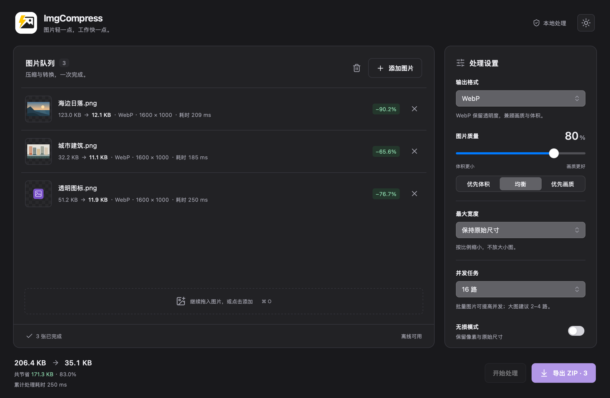
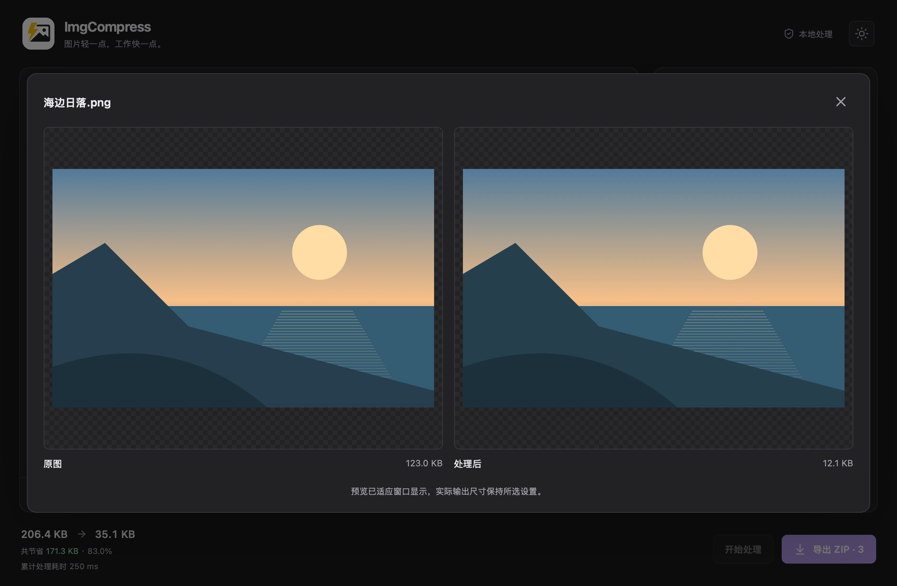

# ImgCompress Mac

**图片轻一点，工作快一点。**

一款轻量的 macOS 图片压缩与格式转换工具。拖入图片，批量处理，一次导出；图片全程留在你的电脑上，离线可用。

**[下载 v0.2.4 · Apple Silicon DMG](https://github.com/wangruofeng/imgcompress-mac/releases/download/v0.2.4/imgcompress-0.2.4-arm64.dmg)**　·　[更新记录](https://github.com/wangruofeng/imgcompress-mac/releases/tag/v0.2.4)　·　[SHA-256 校验](https://github.com/wangruofeng/imgcompress-mac/releases/download/v0.2.4/SHA256SUMS.txt)

适用于 M 系列芯片 Mac，最低 macOS 12。安装包采用 ad-hoc 签名，尚未经过 Apple Developer ID 签名与公证。



## 为什么用它

- **本地处理，离线可用**：图片无需上传，保留原文件。
- **七种常用格式**：JPG、PNG、WebP、AVIF，以及 SVG、GIF、APNG 原格式优化。
- **批量并发，最高 32 路**：支持自动调度与手动选择，展示单张和整批处理耗时。
- **一次导出一个 ZIP**：重名自动编号，保存后在 Finder 中定位。
- **压缩效果看得见**：逐张查看体积变化，点击缩略图对比原图与结果。
- **按需调整**：质量、最大宽度、WebP 无损模式，配合深浅色界面。

## 三步完成

1. **拖入图片**，也可点击「添加图片」或按 `⌘O` 多选。
2. **设置并处理**：选择格式、质量与尺寸，点击「开始处理」。大图建议使用 2–4 路并发。
3. **导出 ZIP**：选择保存文件夹，所有已完成图片打包保存，并自动在 Finder 中选中。

首次安装：打开 DMG，将 ImgCompress 拖入 Applications。

## 格式支持

| 图片类型 | 支持的处理方式 |
| --- | --- |
| JPG / PNG / WebP / AVIF | 静态图片互转、压缩与等比例缩小 |
| SVG | 优化源码，保留矢量；仅支持无脚本、外链等内容的独立 SVG |
| GIF / APNG | 移除非视觉附加元数据，保留动画帧、时序、循环与透明度 |

SVG、GIF、APNG 不应用格式、质量与尺寸设置，优化后体积可能不变。PNG 质量滑块不生效；WebP 无损模式保留解码像素及原尺寸，但不保证文件更小。暂不支持 HEIC、动画 WebP 和动画 AVIF。

单批最多 200 张，单张最大 100 MB、解码后最多 4000 万像素。[查看完整功能边界](docs/reference.md#功能与边界)。

## 更多界面

<details>
<summary>浅色主界面 · 七种格式与并发设置</summary>


</details>

<details>
<summary>原图与处理结果对比</summary>



</details>

截图来自 v0.2.4 的实际 Mac 原生窗口；使用示例图片，压缩比例与耗时仅代表该样本。

## 本地开发

基于 [MyGo](https://mygo.run/zh)、Go、React 与 TypeScript，使用 WKWebView 和本地 WASM 编解码器。需要 Node.js 22+、Go 1.27.3+。

```sh
npm ci
npm run dev
```

运行检查与构建：

```sh
npm run check && npm test && go test ./...
npm run build
```

构建产物位于 `build/`。[开发、原生验证与许可证说明](docs/reference.md) · [CHANGELOG](CHANGELOG.md)

## 作者

由 [Ruofeng Wang（wangruofeng）](https://github.com/wangruofeng) 开发与维护。[GitHub 项目](https://github.com/wangruofeng/imgcompress-mac) · [反馈问题](https://github.com/wangruofeng/imgcompress-mac/issues)

## 开源与来源

[MIT License](LICENSE)。编码方案改编自 [ImgCompress 网站](https://img-compress.wangruofeng007.com/)，窗口与应用沿用同款 Logo。第三方许可证见 [开发参考](docs/reference.md#来源与许可证)。
