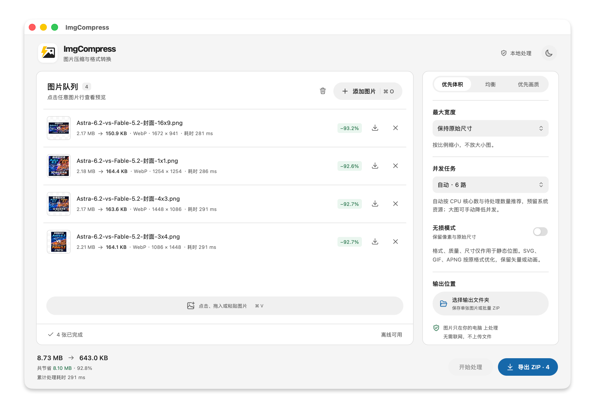
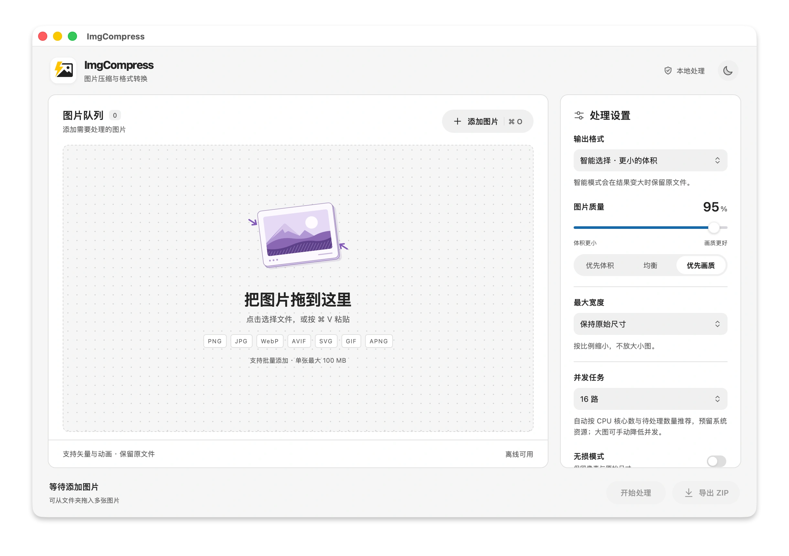
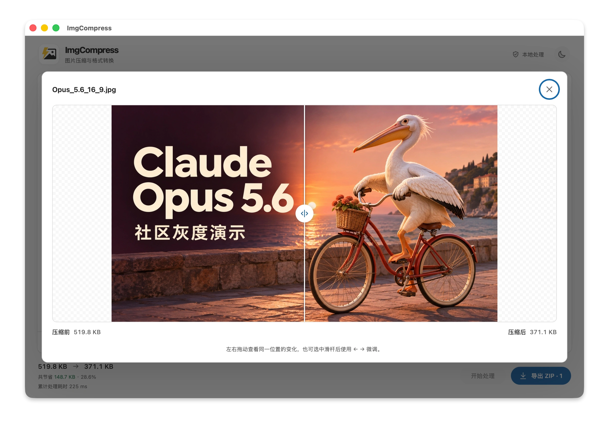

<h1 align="center">
  <br>
  ImgCompress
</h1>

<p align="center"><strong>图片轻一点，工作快一点。</strong></p>

<p align="center">一款轻量的 macOS 和 Windows 图片压缩与格式转换工具。拖入图片，批量处理，一次导出；图片全程留在你的电脑上，离线可用。</p>

<p align="center">
  <a href="https://github.com/wangruofeng/imgcompress/releases/latest"></a>
  <a href="https://github.com/wangruofeng/imgcompress/releases"></a>
  <a href="LICENSE"></a>
</p>

## Mac 宣传片

https://github.com/user-attachments/assets/4f617bfe-404d-443b-b4f4-374a3c46237a

配乐：[《Carefree》](https://www.incompetech.com/music/royalty-free/index.html?isrc=USUAN1400037)（Kevin MacLeod，Incompetech），采用 [CC BY 4.0](https://creativecommons.org/licenses/by/4.0/deed.zh-hans) 授权。已截取片段、调整音量并添加淡入淡出。

[宣传片 HTML 源码](docs/videos/imgcompress-mac-promo.html)

## 下载 v0.3.1

无需安装 App，也可以直接在浏览器中使用 [ImgCompress 在线版](https://img-compress.wangruofeng007.com/)。

| 平台 | 安装包 |
| --- | --- |
| macOS 12+ · Apple Silicon（M 系列） | [下载 ARM64 DMG](https://github.com/wangruofeng/imgcompress/releases/download/v0.3.1/imgcompress-0.3.1-arm64.dmg) |
| macOS 12+ · Intel | [下载 Intel DMG](https://github.com/wangruofeng/imgcompress/releases/download/v0.3.1/imgcompress-0.3.1-amd64.dmg) |
| Windows x64 · Intel / AMD | [下载 Windows 安装程序](https://github.com/wangruofeng/imgcompress/releases/download/v0.3.1/imgcompress-setup-0.3.1-amd64.exe) |

[更新记录](https://github.com/wangruofeng/imgcompress/releases/tag/v0.3.1) · [SHA-256 校验](https://github.com/wangruofeng/imgcompress/releases/download/v0.3.1/SHA256SUMS.txt)

Mac 安装包使用 ad-hoc 签名，尚未经过 Apple 公证。Windows 版需要 Microsoft Edge WebView2 Runtime。



## 为什么用它

- **本地处理，离线可用**：图片无需上传，保留原文件。
- **七种常用格式**：JPG、PNG、WebP、AVIF，以及 SVG、GIF、APNG 原格式优化。
- **批量并发，最高 32 路**：支持自动调度与手动选择，展示单张和整批处理耗时。
- **单张下载或批量导出 ZIP**：重名自动编号，保存后在所在文件夹中定位。
- **压缩效果看得见**：逐张查看体积变化，点击图片行，拖动滑杆对比原图与结果。
- **按需调整**：质量、最大宽度、WebP 无损模式，配合深浅色界面。

## 三步完成

1. **拖入图片**，也可点击「添加图片」多选，或按 ⌘V（Windows 为 Ctrl+V）粘贴。
2. **设置并处理**：选择格式、质量与尺寸，点击「开始处理」。大图建议使用 2–4 路并发。
3. **导出 ZIP**：选择保存文件夹，所有已完成图片打包保存，并自动在所在文件夹中选中。

Mac 用户打开 DMG，将 ImgCompress 拖入 Applications。Windows 用户运行安装程序。

## 格式支持

| 图片类型 | 支持的处理方式 |
| --- | --- |
| JPG / PNG / WebP / AVIF | 静态图片互转、压缩与等比例缩小 |
| SVG | 优化源码，保留矢量；仅支持无脚本、外链等内容的独立 SVG |
| GIF / APNG | 移除非视觉附加元数据，保留动画帧、时序、循环与透明度 |

SVG、GIF、APNG 不应用格式、质量与尺寸设置，优化后体积可能不变。PNG 质量滑块不生效；WebP 无损模式保留解码像素及原尺寸，但不保证文件更小。暂不支持 HEIC、动画 WebP 和动画 AVIF。

单批最多 200 张，单张最大 100 MB、解码后最多 4000 万像素。[查看完整功能边界](docs/reference.md#功能与边界)。

## 更多界面

<details>
<summary>浅色主界面 · 七种格式与并发设置</summary>



</details>

<details>
<summary>原图与处理结果对比</summary>



</details>

截图中的压缩比例与耗时仅代表对应样本。

## 本地开发

基于 [MyGo](https://mygo.run/zh)、Go、React 与 TypeScript，分别使用 macOS WKWebView、Windows WebView2 和本地 WASM 编解码器。需要 Node.js 22+、Go 1.27.3+。

```sh
npm ci
npm run dev
```

运行检查与构建：

```sh
npm run check && npm test && go test ./...
npm run build
```

在 macOS 上运行 `npm run build:mac` 会分别生成 Apple Silicon（`build/darwin-arm64/`）和 Intel（`build/darwin-amd64/`）两个 DMG。只构建一种架构时使用 `npm run build:mac:arm64` 或 `npm run build:mac:intel`。需要单个安装包兼容两种芯片时使用 `npm run build:mac:universal`。在 Windows x64 上运行 `npm run build:windows` 可生成 NSIS 安装程序；使用 `npm run build:windows:portable` 可跨平台生成免安装目录。Windows 运行时需要 Microsoft Edge WebView2 Runtime。

构建产物位于 `build/`。[开发、原生验证与许可证说明](docs/reference.md) · [CHANGELOG](CHANGELOG.md)

## 作者

由 [Ruofeng Wang（wangruofeng）](https://github.com/wangruofeng) 开发与维护。[X @oneruofeng](https://x.com/oneruofeng) · [GitHub 项目](https://github.com/wangruofeng/imgcompress) · [反馈问题](https://github.com/wangruofeng/imgcompress/issues)

## 开源与来源

[MIT License](LICENSE)。编码方案改编自 [ImgCompress 网站](https://img-compress.wangruofeng007.com/)，窗口与应用沿用同款 Logo。第三方许可证见 [开发参考](docs/reference.md#来源与许可证)。
